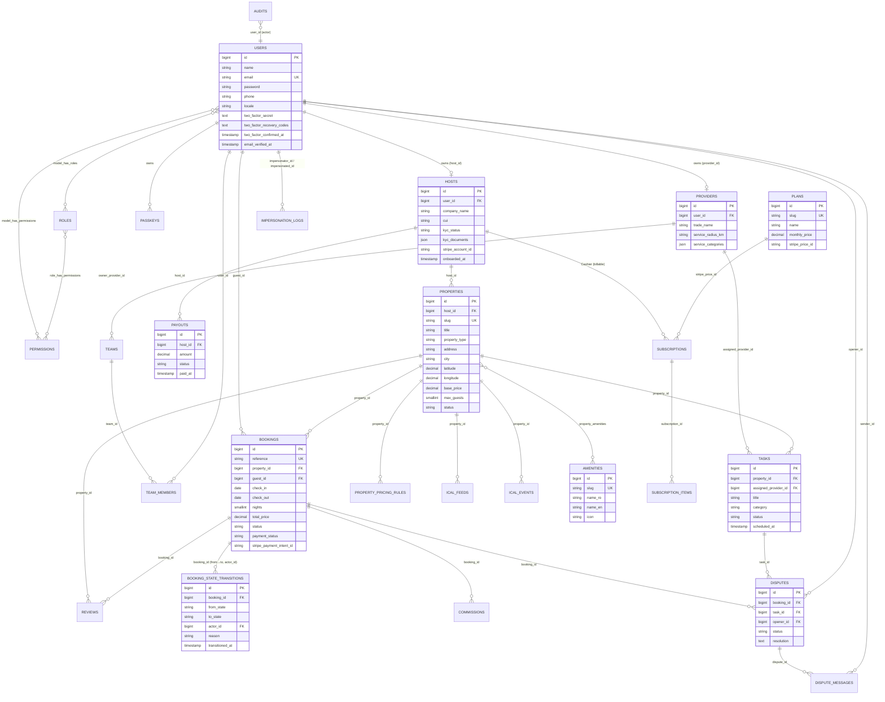

# MRHM — Jurnal de Progres Dezvoltare

> Document de urmărire a dezvoltării platformei **Management Regim Hotelier & Mentenanță**.
> Se actualizează la fiecare sesiune de lucru. Fiecare task are status: ⬜ to-do / 🟦 in-progress / ✅ done / ⚠️ blocked.

---

## 0. Decizii arhitecturale confirmate

| Decizie | Alegere | Motiv |
|---|---|---|
| Backend framework | **Laravel 13.11** | Productivitate, ecosistem matur (latest stable) |
| Frontend stack | **Livewire 3 + Alpine.js** | Monolitic, viteză de dev, fără SPA overhead |
| Bază de date | **PostgreSQL 16 + PostGIS** | Geo queries, JSONB, performanță |
| Cache & Queue | **Redis** + Laravel Horizon | Standard industrie |
| Search | **PostgreSQL FTS** la MVP → **Meilisearch** post-lansare | Cost zero la start |
| Plăți | **Stripe Connect** (split payments) | Comisioane platformă + payout direct la host |
| Abonamente | **Laravel Cashier (Stripe)** | Integrare standard |
| Admin panel | **Filament 3** | SuperAdmin rapid |
| Storage | **DigitalOcean Spaces** (S3-compatible) | Cost mai mic decât AWS în EU |
| Mail | **Mailgun** (tranzacțional) | Free tier generos |
| SMS | **Twilio** + fallback WhatsApp Business | Pentru check-in codes |
| Multi-tenancy | Single DB cu `host_id` discriminator | Simplitate operațională |
| i18n | **RO + EN** de la început | Pregătire expansiune |
| Mobile | **PWA** (nu nativ) | MVP rapid |
| Deploy | **Laravel Forge** + DigitalOcean | Zero-downtime, SSL automat |
| CI/CD | GitHub Actions (Pest + PHPStan L8 + Pint) | Calitate cod |
| Locație proiect | `c:\n\MRHM\app\` | Separare cod / docs |
| Dev environment | **Laravel Sail** (Docker-only) | User nu are PHP/Node/Composer local |
| Runtime PHP image | **PHP 8.5** (Sail default) | Cel mai recent suportat de Laravel 13 |
| Node runtime | **Node 24** (în imaginea Sail) | Vite + Tailwind |

---

## 1. Etape & Milestones

### 🟦 Etapa 0 — Pre-development & Setup
- [x] ✅ Inițializare proiect **Laravel 13.11.2** în `app/` (via container `laravelsail/php83-composer`)
- [x] ✅ Configurare PostgreSQL 16 + **PostGIS 3.4** local (Docker — image `postgis/postgis:16-3.4-alpine`)
- [x] ✅ Redis 7 local (Docker)
- [x] ✅ Mailpit local (Docker — SMTP test 1025, UI 8025)
- [x] ✅ `.env` configurat (APP_NAME=MRHM, locale=ro, fallback=en, DB+Redis pe servicii Docker)
- [x] ✅ `compose.yaml` Sail v1.60 + swap PostGIS
- [x] ✅ Permissions fix pentru `storage/` și `bootstrap/cache/` (chown sail:sail)
- [x] ✅ `APP_KEY` generat
- [x] ✅ Migrațiile default Laravel rulate (users, cache, jobs)
- [x] ✅ Extensia PostGIS activată în DB `mrhm`
- [x] ✅ HTTP smoke test: `GET http://localhost → 200 OK`
- [x] ✅ Git init + `.gitignore` + first commit (`6b2bc71`)
- [x] ✅ Instalare pachete core: **Filament 5.6.5**, **spatie/laravel-permission 7.4.1**, **spatie/laravel-medialibrary 11.22.1**, **laravel/cashier 16.5.3**, **owen-it/laravel-auditing 14.0.3**, **laravel/fortify 1.37.2**, **laravel/horizon 5.47.0**, **spatie/laravel-backup 10.2.1**, **stripe/stripe-php 17.6.0** (115 pachete total)
- [x] ✅ Dev tools: **larastan/larastan 3.9**, **barryvdh/laravel-ide-helper 3.7**
- [x] ✅ `phpstan.neon` configurat (level 6, paths app/config/database/routes)
- [x] ✅ Publicare migrații pachete: media, cashier (subscriptions, customer cols, passkeys, 2FA cols), audits, permissions
- [x] ✅ Migrate rulat — toate tabelele create în DB
- [x] ✅ Filament admin panel instalat (`/admin/login` → 200 OK), `AdminPanelProvider` generat
- [x] ✅ Horizon installed (provider + config)
- [x] ✅ Fortify config + Actions publicate
- [ ] Configurare Pest + Pint (pint deja inclus în Laravel 13)
- [x] ✅ GitHub Actions workflow CI (`.github/workflows/ci.yml` — PHP 8.3, Postgres+PostGIS, Redis, migrate + Pint + PHPStan + Pest)
- [ ] ERD complet (diagramă)

### 🟦 Etapa 1 — Fundație (Auth + RBAC + Migrații)
- [x] ✅ Migrații complete pentru cele ~25 entități (9 fișiere noi: users+, hosts, providers/teams, amenities, properties+PostGIS, bookings+state_transitions, ical, tasks, business: reviews/plans/commissions/payouts/disputes/impersonation)
- [x] ✅ PostGIS geography column `location` + index GIST pe `properties`
- [x] ✅ Seederi: `RolesAndPermissionsSeeder` (4 roluri × 39 permisiuni), `AmenitiesSeeder` (27 amenities cu i18n RO/EN), `AdminUserSeeder` (`admin@mrhm.local` / `password`)
- [x] ✅ Models Eloquent + relații: User (HasRoles), Host, Provider, Team, TeamMember, Property, PropertyPricingRule, Amenity, Booking (cu `ALLOWED_TRANSITIONS` state machine), BookingStateTransition, IcalFeed, IcalEvent, Task, Review (morphTo), Plan, Commission, Payout, Dispute, DisputeMessage, ImpersonationLog
- [x] ✅ Auth (Laravel Breeze cu Blade) — Livewire 3 incompatibil cu Filament 5/Livewire 4, am ales blade stack
- [x] ✅ 4 roluri create: `SuperAdmin`, `Host`, `Provider`, `Guest` (permisiuni sincronizate)
- [x] ✅ Middleware aliases `role`, `permission`, `role_or_permission` înregistrate în `bootstrap/app.php`
- [x] ✅ Audit log: trait `OwenIt\Auditing\Auditable` atașat pe Booking, Property, Host, Provider, Task, Dispute, Payout; tabel `audits` activ
- [ ] 2FA pentru SuperAdmin & Host (laravel/fortify — config publicat)
- [x] ✅ i18n setup: `lang/ro/app.php` + `lang/en/app.php` (common, navigation, booking statuses)
- [x] ✅ BookingObserver — validează tranziții și log automat în `booking_state_transitions`
- [x] ✅ Teste: 7 unit (state machine) + 3 feature (transition logging, invalid transition rejection, happy path lifecycle) — toate verzi

### ⬜ Etapa 2 — Properties + Search
- [ ] CRUD Properties (Host dashboard Livewire)
- [ ] Upload galerie (MediaLibrary + Spaces)
- [ ] Amenities (many-to-many)
- [ ] Search geo (PostGIS `ST_DWithin`) cu index GIST
- [ ] Filtre: dată, oaspeți, preț, rating
- [ ] Pagina publică proprietate + Google Maps embed
- [ ] Recenzii (model + UI)

### ⬜ Etapa 3 — Booking Engine ⚠️ CRITIC
- [ ] State machine booking (`pending → confirmed → checked_in → checked_out → cancelled / refunded`)
- [ ] Algoritm anti-overbooking (DB lock `FOR UPDATE` + buffer 1h)
- [ ] iCal import (parser + cron 5 min)
- [ ] iCal export (feed `.ics` per property)
- [ ] Flow rezervare guest (search → select → checkout)
- [ ] Reconciliere periodică cu surse externe
- [ ] **Pest tests** pentru concurență (obligatoriu)

### ⬜ Etapa 4 — Plăți (Stripe Connect)
- [ ] Onboarding host ca Connected Account
- [ ] Checkout cu `application_fee` (comision platformă)
- [ ] Webhooks: `payment_intent.*`, `account.updated`, `payout.paid`, `charge.refunded`
- [ ] Refund flow
- [ ] Facturi PDF (DomPDF)
- [ ] Subscription pentru hosts (Cashier — plan Basic/Premium)

### ⬜ Etapa 5 — Mentenanță
- [ ] Tasks engine + event `BookingCheckedOut → CreateCleaningTask`
- [ ] Reguli de auto-asignare (host → provider preferat)
- [ ] Provider dashboard (Livewire)
- [ ] Proof of work (before/after photos)
- [ ] Sub-roluri în firmă (team members)
- [ ] Raport lunar provider → host (PDF)

### ⬜ Etapa 6 — SuperAdmin (Filament)
- [ ] Resources pentru toate entitățile
- [ ] User Impersonation + audit log
- [ ] KYC approval workflow (CUI / CI upload)
- [ ] Dispute management
- [ ] Plans configurator
- [ ] Dashboard: MRR, Churn, GMV, bookings
- [ ] Alertă "host inactiv > 7 zile"

### ⬜ Etapa 7 — Notificări, Hardening, Lansare
- [ ] Mailgun integration + templates
- [ ] Twilio SMS (check-in codes)
- [ ] WhatsApp Business fallback
- [ ] Rate limiting + throttling
- [ ] Cloudflare WAF
- [ ] Backup automat DB (zilnic) + S3 lifecycle
- [ ] Forge deploy + zero-downtime
- [ ] Horizon monitoring
- [ ] PWA manifest + service worker
- [ ] Launch checklist (smoke tests pe production)

---

## 2. Stack tehnic complet

```
PHP 8.3
Laravel 11.x
Livewire 3.x
Filament 3.x
PostgreSQL 16 + PostGIS 3.4
Redis 7
Node 20 (Vite + TailwindCSS 3)
```

**Pachete Composer principale:**
- `filament/filament` — admin panel
- `livewire/livewire` — UI reactive
- `spatie/laravel-permission` — RBAC
- `spatie/laravel-medialibrary` — uploads
- `laravel/cashier` — subscriptions Stripe
- `stripe/stripe-php` — Connect API
- `owen-it/laravel-auditing` — audit log
- `laravel/horizon` — queue monitor
- `laravel/fortify` — 2FA
- `spatie/laravel-backup` — DB backups
- `stechstudio/filament-impersonate`
- `mpociot/laravel-apidoc` (opțional, dacă expunem API)

**Dev tools:**
- `pestphp/pest` + `pestphp/pest-plugin-laravel`
- `larastan/larastan` (PHPStan L8)
- `laravel/pint`
- `barryvdh/laravel-debugbar` (dev only)

---

## 3. Schema bazei de date (entități)

```
users (id, email, password, phone, locale, 2fa_secret, ...)
roles, permissions, role_user, permission_role  [spatie]
audit_logs                                        [owen-it]
impersonation_logs (admin_id, target_id, started_at, ended_at, reason)

hosts (user_id, company_name, cui, kyc_status, kyc_documents, stripe_account_id)
providers (user_id, company_name, cui, kyc_status, service_types[])
teams (provider_id, name)
team_members (team_id, user_id, role)

properties (id, host_id, slug, title, description, address, city, country,
            location POINT, base_price, currency, max_guests, bedrooms,
            check_in_time, check_out_time, status, ...)
property_media [polymorphic via MediaLibrary]
amenities (id, slug, icon)
property_amenities (property_id, amenity_id)
property_pricing_rules (property_id, type, dates, price_modifier)

bookings (id, property_id, guest_id, check_in, check_out, guests_count,
          total_price, platform_fee, host_payout, currency,
          status, source [direct|airbnb|booking], external_id,
          stripe_payment_intent_id, created_at, ...)
booking_state_transitions (booking_id, from, to, actor_id, at, reason)

ical_feeds (id, property_id, direction [in|out], url, last_sync_at, last_error)
ical_events (id, feed_id, uid, start, end, summary, raw)

tasks (id, property_id, booking_id, type [cleaning|repair|inspection],
       provider_id, assigned_to_user_id, status, priority,
       scheduled_at, completed_at, cost, notes)
task_media [polymorphic — before/after photos]

reviews (id, booking_id, author_id, target_type, target_id, rating, comment)

plans (id, slug, name, price, interval, features JSONB, stripe_price_id)
subscriptions, subscription_items  [Cashier]

commissions (id, booking_id, amount, percentage, status)
payouts (id, host_id, stripe_transfer_id, amount, status)

disputes (id, booking_id|task_id, opener_id, status, resolution)
dispute_messages (dispute_id, sender_id, body, attachments)

notifications  [Laravel native]
```

### 3.1. ERD — diagramă Mermaid



> Notă: relațiile polimorfice `audits` (OwenIt) și `media` (Spatie MediaLibrary) sunt atașate tuturor modelelor cu trait-ul corespunzător (Booking, Property, Host, Provider, Task, Dispute, Payout).

---

## 4. Jurnal de sesiuni

### Sesiune 2026-05-26 — Kickoff
- ✅ Analiză plan inițial
- ✅ Decizii arhitecturale confirmate
- ✅ Document de progres creat
- ✅ **Etapa 0 — Docker stack operațional**:
  - Proiect Laravel 13.11.2 bootstrap via `laravelsail/php83-composer`
  - Sail 1.60 + `compose.yaml` cu pgsql/redis/mailpit
  - Swap imagine PostgreSQL → `postgis/postgis:16-3.4-alpine`
  - 4 containere `Up`: `app-laravel.test-1`, `app-pgsql-1`, `app-redis-1`, `app-mailpit-1`
  - `.env` ajustat (MRHM, locale ro/en, Redis pentru session/cache/queue, `WWWUSER`/`WWWGROUP=1000`)
  - Permissions `storage/` + `bootstrap/cache/` reparate (chown `sail:sail`)
  - `APP_KEY` generat, migrațiile default rulate (3 tabele Laravel default)
  - Extensia `postgis` activată în DB `mrhm` → versiune 3.4 verificată
  - HTTP smoke test: `GET http://localhost` → **200 OK** (70.4 KB welcome page)
- **Notă perf**: Bind mount Windows este lent (~14s/request pentru welcome page). De rezolvat ulterior cu volum named pentru `vendor/` sau migrare în WSL2.
- **Servicii UI accesibile**:
  - App: http://localhost
  - Mailpit (mail UI): http://localhost:8025
  - PostgreSQL: `localhost:5432` (user `mrhm` / db `mrhm` / pass `secret`)
- 🟦 Următor: Git init + instalare pachete core (Etapa 0 → finalizare) și apoi Etapa 1.

### Sesiune 2026-05-26 (continuare) — Etapa 0 finalizată
- ✅ **Git init** + `.gitignore` + commit `6b2bc71` ("Initial commit: MRHM Laravel 13 + Docker stack (Etapa 0)")
- ✅ **Pachete core instalate** (9 directe + 106 tranzitive = 115 total):
  - Filament 5.6.5 (admin panel)
  - Spatie: laravel-permission 7.4.1, laravel-medialibrary 11.22.1, laravel-backup 10.2.1
  - Laravel: cashier 16.5.3, fortify 1.37.2, horizon 5.47.0
  - owen-it/laravel-auditing 14.0.3, stripe/stripe-php 17.6.0
- ✅ **Dev tools**: larastan/larastan 3.9, barryvdh/laravel-ide-helper 3.7
- ✅ **`phpstan.neon`** creat (level 6, paths app/config/database/routes)
- ✅ **Vendor publish & migrate**: media_table, Cashier (subscriptions, subscription_items, customer columns, meter cols, passkeys, 2FA columns), audits, permission_tables — toate migrate cu succes
- ✅ **Filament admin panel** instalat — `AdminPanelProvider` la `app/Providers/Filament/`, rute `/admin`, `/admin/login`, `/admin/logout` → HTTP **200 OK** pe `/admin/login`
- ✅ **Horizon** (provider + config) + **Fortify** (config + Actions) publicate
- **Notă debugging**: Composer install pe bind-mount Windows este lent (~5-10 min per pachet din cauza unzip-ului). Workaround: `COMPOSER_PROCESS_TIMEOUT=0`. Permisiunile pentru fișiere noi trebuie reaplicate după fiecare composer require: `chown -R sail:sail storage bootstrap/cache database config app routes lang`.
- 🟦 Următor: Pest setup, user admin Filament, GitHub Actions CI, ERD, apoi Etapa 1 (migrații complete pentru cele ~25 entități, modele + factories, Breeze Livewire, RBAC cu 4 roluri).

### Sesiune 2026-05-26 (continuare 2) — Etapa 1 fundație
- ✅ **9 migrații noi** rulate cu succes (toate tabelele core MRHM):
  - `add_profile_columns_to_users_table` (phone, locale, avatar, last_login)
  - `create_hosts_table` (cu KYC, Stripe Connect)
  - `create_providers_and_teams_tables` (providers, teams, team_members)
  - `create_amenities_table`
  - `create_properties_table` (cu `location geography(POINT, 4326)` + index GIST + pricing_rules + property_amenities pivot)
  - `create_bookings_table` (cu state machine + booking_state_transitions)
  - `create_ical_tables` (ical_feeds + ical_events)
  - `create_tasks_table` (cleaning, repair, inspection)
  - `create_business_tables` (reviews polimorfic, plans, commissions, payouts, disputes, dispute_messages, impersonation_logs)
- ✅ **41 tabele publice** în DB (35 MRHM + 6 PostGIS metadata)
- ✅ **3 seederi**:
  - `RolesAndPermissionsSeeder` — 4 roluri (SuperAdmin, Host, Provider, Guest) cu 39 permisiuni mapate granular
  - `AmenitiesSeeder` — 27 amenități (basic, kitchen, bathroom, outdoor, safety, family) cu nume RO+EN
  - `AdminUserSeeder` — `admin@mrhm.local` / `password` cu rol SuperAdmin
- ✅ **19 modele Eloquent** create cu relații complete:
  - User actualizat cu `HasRoles` (Spatie) + casts pentru profile cols
  - Host, Provider, Team, TeamMember, Amenity, Property (cu morphMany reviews), PropertyPricingRule
  - Booking (constante `STATUSES` + `ALLOWED_TRANSITIONS` pentru state machine + helper `canTransitionTo()`)
  - BookingStateTransition, IcalFeed, IcalEvent, Task, Review (morphTo target), Plan, Commission, Payout, Dispute, DisputeMessage, ImpersonationLog
- ✅ **i18n stubs**: `lang/ro/app.php` + `lang/en/app.php` (common UI, navigation, booking statuses)
- ✅ **GitHub Actions CI**: `.github/workflows/ci.yml` cu matrix Postgres+PostGIS+Redis, rulează Pint + PHPStan + Pest pe push/PR în main/develop
- ✅ **Verificare smoke** prin script PHP: User SuperAdmin → 39 permisiuni, 27 amenities, 8 statusuri booking corecte
- ✅ **Filament `/admin/login` → HTTP 200 OK** după migrate+seed

### Sesiune 2026-05-26 (continuare 3) — Etapa 1 finalizare (auth + audit + observer + teste)
- ✅ **Laravel Breeze blade** instalat (stack Livewire 3 incompatibil cu Filament 5 care folosește Livewire 4 — am switch-at la blade; rutele auth `/login`, `/register`, `/forgot-password`, `/profile` + Vite build OK)
- ✅ **Middleware aliases** Spatie înregistrate în `bootstrap/app.php`: `role`, `permission`, `role_or_permission`
- ✅ **`OwenIt\Auditing` activat**:
  - Config publicat (`config/audit.php`)
  - Migration `create_audits_table` (făcut idempotent cu `Schema::hasTable` pentru a tolera tabelul preexistent)
  - Trait `Auditable` atașat pe **Booking, Property, Host, Provider, Task, Dispute, Payout** (interfață `OwenIt\Auditing\Contracts\Auditable`)
- ✅ **BookingObserver** (`app/Observers/BookingObserver.php`):
  - `updating()` → validează tranziția față de `Booking::ALLOWED_TRANSITIONS`, aruncă `InvalidArgumentException` la tranziții invalide
  - `updated()` → log automat în `booking_state_transitions` cu `from_state`, `to_state`, `actor_id`, `reason`, `transitioned_at`
  - Înregistrat în `AppServiceProvider::boot()`
- ✅ **PostGIS extension migration** `2026_05_26_069999_enable_postgis_extension.php` (`CREATE EXTENSION IF NOT EXISTS postgis`) — necesar pentru DB-ul `testing` care nu avea extensia
- ✅ **Pest/PHPUnit teste verzi**:
  - `tests/Unit/BookingStateMachineTest.php` — 6 teste (43 assertions): tranziții permise per status, stare terminală `refunded`, integritate map STATUSES↔ALLOWED_TRANSITIONS
  - `tests/Feature/BookingTransitionTest.php` — 3 teste (RefreshDatabase + seed roles): tranziție validă loghează, tranziție invalidă aruncă & nu loghează, happy path complet 3 tranziții
  - Total: **10 teste verzi, 47 assertions** rulează în ~63s pe DB testing
- ✅ **CI ajustat**: workflow folosește `php artisan test` (PHPUnit) în loc de Pest CLI (Pest nu este instalat ca dep dedicat, runner-ul Laravel îl suportă oricum)
- **Note**: Breeze Livewire amânat până la upgrade compatibil sau înlocuire cu volt-4. Factories încă nu sunt scrise (modele create manual în teste). Anti-overbooking cu DB lock urmează în Etapa 3.
- ✅ **Filament resources generate** pentru 7 modele via `make:filament-resource ... --generate`:
  - `Hosts/HostResource`, `Properties/PropertyResource`, `Bookings/BookingResource`, `Tasks/TaskResource`, `Disputes/DisputeResource`, `Plans/PlanResource`, `Amenities/AmenityResource`
  - Form + Table schemas auto-derivate din coloanele DB (split classes Filament 5.x: `Schemas/*Form`, `Tables/*Table`, `Pages/{List,Create,Edit}*`)
  - Configurate manual: `navigationLabel`, `modelLabel`, `pluralModelLabel` în RO, `navigationGroup` (Marketplace / Operațional / Configurare), `navigationSort`, `recordTitleAttribute` (reference / title / name_ro)
  - Admin panel verificat HTTP 200 după `config:clear && view:clear && cache:clear`
- ✅ **Factories Eloquent**: `HostFactory`, `PropertyFactory`, `BookingFactory` (cu states `pending`/`confirmed`); `UserFactory` exista deja
- ✅ **Anti-overbooking** via `App\Services\BookingService::create()`:
  - `DB::transaction` cu `Property::lockForUpdate()` (row-level lock per property)
  - Detecție overlap în aceeași tranzacție (`check_in < new.check_out AND check_out > new.check_in`) cu `lockForUpdate` pe bookings
  - Statusurile active blocante: `pending`, `confirmed`, `checked_in`; cancelled/refunded/no_show/checked_out/disputed nu blochează
  - Aruncă `RuntimeException("Overbooking refuzat…")`
- ✅ **`tests/Feature/BookingOverbookingTest.php`** — 4 teste verzi:
  - first booking creates OK
  - overlapping booking → RuntimeException
  - adjacent booking (check_out == check_in) → allowed
  - cancelled booking nu blochează slot-ul
- ✅ **Total teste: 13 verzi (53 assertions), durată ~46s**
- ✅ **Redirect post-login per rol** (`App\Support\RoleRedirector::pathFor()`):
  - `SuperAdmin → /admin`, `Host → /host`, `Provider → /provider`, default → `/dashboard`
  - Integrat în `AuthenticatedSessionController::store()`
  - Rute placeholder `/host`, `/provider` cu middleware `role:Host` / `role:Provider` (vor primi UI proprie în Etapele 4-5)
- ✅ **`tests/Feature/RoleRedirectTest.php`** — 5 teste verzi (SuperAdmin, Host, Provider, Guest fallback, no-role fallback)
- ✅ **Total teste cumulat: 18 verzi (63 assertions)**
- ✅ **2FA fundație via Laravel Fortify ^1.37**:
  - `composer require laravel/fortify` + `FortifyServiceProvider` înregistrat în `bootstrap/providers.php`
  - `User` implementează `FilamentUser` (cu `canAccessPanel()` care permite doar `SuperAdmin` în panel-ul `admin`) și folosește trait-ul `TwoFactorAuthenticatable`
  - `config/fortify.php` redus la doar `Features::twoFactorAuthentication([confirm, confirmPassword])` (registration/login/profile/passkeys eliminate — le gestionează Breeze)
  - `Fortify::ignoreRoutes()` pentru a evita conflictele cu Breeze
  - Migrații 2FA + passkeys deja aplicate (`add_two_factor_columns_to_users_table`, `create_passkeys_table`)
  - Coloanele `two_factor_secret`, `two_factor_recovery_codes` adăugate în `#[Hidden]`
- ✅ **Middleware `EnsureTwoFactorAuthenticated`** (alias `require_2fa`):
  - Pentru rolurile `SuperAdmin` și `Host`, redirecționează la `/two-factor-setup` dacă 2FA nu este confirmat
  - Aplicat pe Filament admin panel (`AdminPanelProvider::authMiddleware`) și pe ruta `/host`
  - Pagină placeholder `/two-factor-setup` (view Breeze) explicând că UI completă urmează
- ✅ **`tests/Feature/TwoFactorAuthenticationTest.php`** — 7 teste verzi (trait, coloane, redirect SuperAdmin/Host, Provider nu necesită 2FA, accesibil cu 2FA confirmat, no-loop pe setup)
- ✅ **Total teste cumulat: 50 verzi (136 assertions), durată ~79s**
- ✅ **ERD diagram Mermaid** adăugat în secțiunea 3.1 (entități domeniu + relațiile lor: USERS, HOSTS, PROVIDERS, PROPERTIES, BOOKINGS, BOOKING_STATE_TRANSITIONS, TASKS, DISPUTES, COMMISSIONS, PAYOUTS, PLANS, AMENITIES, PASSKEYS, ROLES/PERMISSIONS)

### Sesiune — Etapa 2 (6a.1): Property MediaLibrary integration
- ✅ **`Property` model** — `implements HasMedia` + `use InteractsWithMedia` (Spatie MediaLibrary 11)
  - Colecții: `photos` (multi-file, disk `public`, mime: jpeg/png/webp) și `floor_plans` (single-file, mime: jpeg/png/webp/pdf)
  - Conversii: `thumb` (Crop 400×300) + `medium` (Contain 1200×900), nonQueued
- ✅ **`tests/Feature/PropertyMediaTest.php`** — 4 teste verzi: atașare foto la colecția `photos`, multi-photo, single-file pe `floor_plans` (înlocuire), URL generation
- ✅ **Total teste cumulat: 54 verzi (146 assertions), durată ~86s**
- 🟦 Următor (pas cu pas): (6a.2) Livewire + Volt + Property index/show public; (6a.3) Host-facing Property edit page cu upload foto; apoi (6b) Search PostGIS `ST_DWithin` + filtre amenities.

### Sesiune — Etapa 2 (6a.2): Public Property pages (Volt)
- ✅ **Volt 1.10** instalat (`composer require livewire/volt` + `volt:install`); `VoltServiceProvider` înregistrat, mount path `resources/views/livewire`
- ✅ **Layout public** `resources/views/components/layouts/public.blade.php` (header cu logo + nav: Proprietăți / Login / Înregistrare / Dashboard)
- ✅ **`/properties`** (Volt `properties.index`) — listă paginată (12/pag.), filtre live: search (titlu/descriere ILIKE), city, property_type, minGuests; doar `status = published`
- ✅ **`/properties/{property:slug}`** (Volt `properties.show`) — galerie foto (`getMedia('photos')` cu conversia `medium`), descriere, specs (oaspeți/dormitoare/paturi/băi), listă dotări, sidebar preț + taxă curățenie; 404 pentru draft
- ✅ Layout aplicat via `#[Layout('components.layouts.public')]`; root element unic `<div>` în template (cerință Livewire)
- ✅ **`tests/Feature/PropertyPublicPagesTest.php`** — 6 teste verzi: acces public index, excludere draft din index, filtrare după city, filtrare după property_type (via `Volt::test()`), acces public show, 404 pe draft
- ✅ **Total teste cumulat: 60 verzi (160 assertions), durată ~108s**
- 🟦 Următor (pas cu pas): (6a.3) Host Property edit page cu upload foto (Livewire `WithFileUploads` sau Filament Resource cu SpatieMediaLibraryFileUpload); apoi (6b) Search PostGIS `ST_DWithin` + filtre amenities.

### Sesiune — Etapa 2 (6a.3): Filament Property photo upload
- ✅ **Plugin** `filament/spatie-laravel-media-library-plugin ^5.6` instalat
- ✅ **`PropertyForm`** (Filament Schema):
  - `SpatieMediaLibraryFileUpload::make('photos')` — colecția `photos`, disk `public`, `image()->multiple()->reorderable()->appendFiles()->responsiveImages()`, max 8MB, mime: jpeg/png/webp, `columnSpanFull()`
  - `SpatieMediaLibraryFileUpload::make('floor_plans')` — colecția `floor_plans`, max 8MB, mime: jpeg/png/webp/pdf, `columnSpanFull()`
  - `property_type` → `Select` cu opțiunile [apartment, house, villa, studio, cabin]
  - `status` → `Select` cu [draft, published, paused, archived], default `draft`
  - Eliminate: `TextInput::make('location')`, `rating_avg`, `reviews_count`; prefix `base_price` schimbat `$` → `RON`
- ✅ **`PropertiesTable`** — adăugat `SpatieMediaLibraryImageColumn::make('cover')` (colecția `photos`, conversia `thumb`, circular) ca prima coloană; eliminat `TextColumn::make('location')`
- ✅ **`tests/Feature/PropertyFilamentMediaTest.php`** — 4 teste verzi: render CreateProperty (form fields photos+floor_plans), upload `photos` via EditProperty, upload `floor_plan`, listare pagina `/admin/properties`. Admin actează cu rol SuperAdmin + 2FA confirmat (`two_factor_confirmed_at`) ca să treacă de middleware-ul `Require2FA`. Seed `RolesAndPermissionsSeeder` în `setUp()`.
- ✅ **Total teste cumulat: 64 verzi (175 assertions), durată ~166s**
- 🟦 Următor (pas cu pas): (6b) Search PostGIS `ST_DWithin` + filtre amenities pe `/properties`.

### Sesiune — Etapa 2 (6b): Search PostGIS + filtre amenities
- ✅ **`/properties` (Volt `properties.index`)** — adăugate proprietăți reactive: `lat`, `lng`, `radiusKm`, `amenities[]`
- ✅ **Filtru geografic** `ST_DWithin(location, ST_SetSRID(ST_MakePoint(lng,lat), 4326)::geography, radius_metri)` via `whereRaw`; folosește indexul GIST existent pe `properties.location`
- ✅ **Filtru amenities** — checkbox per `Amenity`; `whereHas` per ID în buclă → semantică AND (proprietatea trebuie să aibă **toate** dotările bifate)
- ✅ **UI** — al doilea rând de filtre (lat/lng/rază km) + secțiune cu checkbox-uri din `Amenity::all()` sortate după `sort_order`, `name_ro`; reset paginare la schimbare filtru
- ✅ **`tests/Feature/PropertyGeoSearchTest.php`** — 4 teste verzi:
  - rază mică (50 km, București centru) include proprietatea din Centru, exclude pe cea din Cluj
  - rază mare (500 km) include ambele
  - filtru pe o singură dotare (`wifi`) — exclude proprietatea fără ea
  - filtru pe două dotări (`wifi` + `parking`) — doar proprietatea care le are pe ambele (AND)
- ✅ Setup test: `DB::statement` cu `ST_SetSRID(ST_MakePoint(?,?), 4326)::geography` pentru a popula `location`
- ✅ **Total teste cumulat: 68 verzi (183 assertions), durată ~137s**
- 🟦 Următor (pas cu pas): Booking flow public (calendar disponibilitate + checkout).

### Sesiune — Etapa 2 (Booking flow public): /properties/{slug}/book + /bookings/{ref}
- ✅ **Rute web** (`routes/web.php`):
  - `Volt::route('/properties/{property:slug}/book', 'properties.book')->middleware(['auth','verified'])->name('properties.book')`
  - `Volt::route('/bookings/{booking:reference}', 'bookings.show')->middleware(['auth'])->name('bookings.show')`
- ✅ **Componentă Volt `properties.book`** (`resources/views/livewire/properties/book.blade.php`):
  - Props: `Property $property`, `checkIn`, `checkOut`, `guestsCount=1`, `specialRequests`, `errorMessage`
  - `mount()` validează `status==='published'` (404 altfel) + setează datele implicite (azi+1 / azi+3)
  - `#[Computed] nights()`, `subtotal()`, `total()` — calcul reactiv pe baza `base_price * nights + cleaning_fee`
  - `save(BookingService $service)` validează formularul și apelează `BookingService::create($property->id, [...checkIn/checkOut, guests_count, status=pending, payment_status=pending, source=direct...])`; capturează `\RuntimeException` (suprapunere) și redirecționează la `bookings.show` în caz de succes
  - UI: formular date + sidebar breakdown preț cu `data-testid="confirm-booking"` și banner eroare `data-testid="overbooking-error"`
- ✅ **Componentă Volt `bookings.show`** (`resources/views/livewire/bookings/show.blade.php`):
  - Acces restricționat: doar guest-ul rezervării sau host-ul proprietății (403 altfel)
  - Afișează referință, status, proprietate, interval, defalcare preț (testid-uri `booking-reference`, `booking-status`, `booking-total`)
- ✅ **Link „Rezervă"** adăugat în `properties.show` (testid `book-button`) către `route('properties.book', $property)`
- ✅ **`BookingService`** reutilizat: `DB::transaction` + `Property::lockForUpdate` + overlap check pe statusurile [pending, confirmed, checked_in]
- ✅ **`tests/Feature/PublicBookingFlowTest.php`** — 6 teste verzi:
  - guest neautentificat → redirect login pe pagina de booking
  - user autentificat poate vedea pagina de booking
  - user autentificat poate crea o rezervare (3 nopți × 200 RON + 50 cleaning = 650 RON, status `pending`)
  - rezervare suprapusă peste interval [pending/confirmed/checked_in] respinsă cu mesaj „suprapune"
  - pagina `bookings.show` vizibilă guest-ului proprietar
  - pagina `bookings.show` interzisă altui user (403)
- ✅ **Lecție tehnică**: `source` din enum-ul `bookings` are valorile `direct/airbnb/booking/vrbo/ical/manual` (nu `web`). În plus, `\RuntimeException` capturat în `save()` este o categorie largă — `QueryException` și `ModelNotFoundException` extind tot `RuntimeException`. Pe viitor: introducere `OverbookingException` custom pentru a izola eroarea de suprapunere de erorile DB.
- ✅ **Total teste cumulat: 74 verzi (200 assertions), durată ~199s**
- 🟦 Următor (pas cu pas): Review/Rating submission flow, Host dashboard CRUD properties, Notificări email (booking confirmat/anulat) sau Stripe checkout (payment_intent + webhook) — la alegerea utilizatorului.

---

## 5. Backlog / idei post-MVP
- API publică REST pentru integrări terțe
- App nativă (Capacitor peste PWA)
- Smart lock integration (Nuki, TTLock)
- Dynamic pricing AI (sugestii de preț pe baza ocupării)
- e-Factura ANAF integration
- Multi-currency display + FX rates
- Loyalty program guests
- Channel manager extins (Vrbo, Expedia)
